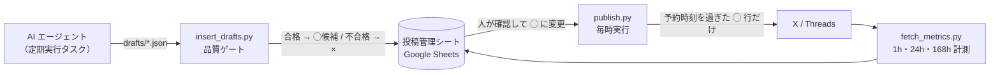

# LLM Post Approval Engine

**LLM が下書きを作り、人が承認した投稿だけを配信する** SNS 投稿エンジン（X / Threads）。
Python と GitHub Actions だけで動き、Google スプレッドシートを承認画面として使います。

> 個人開発アプリの発信用に作り、実際に毎日運用しているシステムの公開版です。
> 個人情報・運用データ・アカウント固有の設定は除き、仕組みとテストはそのまま残しています。


---

## なぜ作ったか

LLM に SNS 投稿を全自動で書かせると、次の3つで事故が起きました。

| 起きたこと | 原因 | このエンジンでの対策 |
|---|---|---|
| 存在しない体験談や数字を書く | LLM の自己ファクトチェックをすり抜ける | **人が最後に承認**しないと配信されない。事実台帳（ペルソナ）に無い内容は NG ワードで機械的に止める |
| X が 403 で投稿を拒否し、ツリーの途中だけが残る | 280 重み超過・類似投稿を X が同じ 403 で返す | 投げる**前に**文字数（X の重み方式）と類似度を判定して弾く |
| 似た投稿が続いてフォローが外れる | LLM は直近の投稿を覚えていない | 直近40件との類似度ゲート、直近投稿をプロンプトに注入 |

「LLM の出力を信用しない前提で、人とルールで挟む」ことを設計の中心にしています。

---

## 全体の流れ



1. **下書き**：AI エージェントが `prompts/daily-drafts.example.md` に従って JSON を作る（投稿はしない）
2. **品質ゲート**：`scripts/insert_drafts.py` が文字数・類似度・NG ワード・編集ルールを検査し、引っかかった行は配信不可（×）でシートに入れる
3. **承認**：人がシートで内容を確認し、配信可否を ◯ に変える。**◯ 以外は絶対に投稿されない**
4. **配信**：`publish.py` が予約時刻を過ぎた ◯ 行だけを X / Threads へツリー投稿し、URL をシートに記録
5. **計測**：`fetch_metrics.py` が公開から 1・24・168 時間後のインプレッション・いいね・返信を記録し、次の下書きの改善に使う

---

## 品質ゲート（LLM の出力を機械で検査する）

| ゲート | 実装 | 内容 |
|---|---|---|
| 文字数 | `utils/limits.py` | X は重み方式（全角2・半角1・URL は一律23、上限280）、Threads は改行除き500字。**1要素でも超えたらツリー全体を投げない**（途中で落ちて孤児投稿が残るのを防ぐ） |
| 類似度 | `generate.py` / `publish.py` | 直近投稿との類似度 0.5 以上は ×。配信直前にも正規化した本文で重複チェック（0.75） |
| NG ワード | `generate.py` | ペルソナの事実と矛盾する既知の語（使っていないモデル名など）を含むと × |
| 編集ルール | `utils/content_quality.py` | 投稿タイプ・文字数レンジ・句点後の改行・定型句・**画像が本文の何を証明するか**・事実の出典の有無を検査 |

ゲートに落ちた下書きは「直して再投入」が原則で、ゲート側は緩めません。

---

## 運用で効いた設計

- **部分失敗を記録する**：ツリーの3本目で失敗しても、1〜2本目の URL はシートに残す（記録の無い投稿を作らない）
- **Threads の伝播待ち**：返信コンテナの公開は親投稿の伝播待ちで失敗するため、ステータスをポーリングし、一時的なエラー（code 24）だけをバックオフ付きで再試行
- **Sheets の数値丸め対策**：17〜19桁の投稿 ID が float に丸められないよう `RAW` で書き込む
- **計測は実公開時刻基準**：予約時刻ではなく実際に公開された時刻からの経過で計測し、どちらの基準で測ったかも記録する。返信数から自分のツリー分を引いて読者の返信だけを数え、計算できない場合は 0 と区別して「欠測」と記録
- **トークンの自動更新**：Threads の長期トークン（60日）を毎月リフレッシュし、Actions Secret に書き戻す
- **Actions ストレージの自動掃除**：毎時実行のログで無料枠を使い切った経験から、古い実行ログを定期削除

---

## ディレクトリ構成

```text
.
├── publish.py               # ◯ 行を X / Threads へ配信（重複・文字数ガード、部分失敗の記録）
├── fetch_metrics.py         # 1h / 24h / 168h のエンゲージメント計測
├── generate.py              # API 生成モード（Gemini で6投稿を生成 → ゲート → シート）
├── utils/
│   ├── llm.py               # Gemini 呼び出し・プロンプト組み立て（ペルソナは外部ファイル）
│   ├── limits.py            # X の重み・Threads の文字数判定
│   ├── content_quality.py   # 編集ルールの品質ゲート
│   └── gsheets.py           # シート操作（リトライ付き）
├── scripts/
│   ├── insert_drafts.py     # 下書き JSON → 品質ゲート → シート
│   ├── add_metrics_columns.py
│   ├── refresh_threads_token.sh
│   └── cleanup_actions_storage.sh
├── prompts/
│   ├── persona.example.md       # 事実台帳・口調・禁止事項のサンプル
│   └── daily-drafts.example.md  # エージェント向け下書きプロンプトのサンプル
├── drafts/example.json      # 下書き JSON の例
├── tests/                   # pytest（外部 API はすべてモック）
└── .github/workflows/       # 配信・計測・下書き投入・トークン更新・掃除・テスト
```

---

## セットアップ

```bash
git clone https://github.com/HiromuMorisaki/llm-post-approval-engine.git
cd llm-post-approval-engine
pip install -r requirements.txt

cp .env.example .env                                   # API キーを記入
cp prompts/persona.example.md prompts/persona.md       # 自分の事実台帳に書き換え（.gitignore 済み）
```

1. Google Cloud でサービスアカウントを作り、Sheets API を有効化して、投稿管理シートに編集者として共有する
2. X Developer Portal / Threads API でトークンを取得する
3. GitHub の `Settings > Secrets and variables > Actions` に `.env.example` と同名で登録する
4. 定期実行を有効にするには、リポジトリ変数 `ENABLE_AUTOMATION` を `true` にする
   （未設定のままなら、定期ワークフローはスキップされ、テストだけが動きます）

### 下書きの投入

```bash
python scripts/insert_drafts.py drafts/example.json
```

### テスト

```bash
python -m pytest -q
```

外部 API（LLM・Sheets・X・Threads）はすべてモックしており、キー無しで実行できます。

---

## 技術スタック

Python 3.10 · Gemini API (google-genai) · GitHub Actions · Google Sheets API (gspread) · X API v2 (tweepy) · Threads Graph API · pytest
